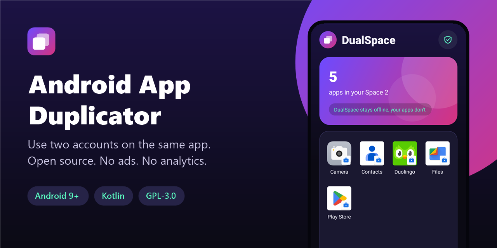
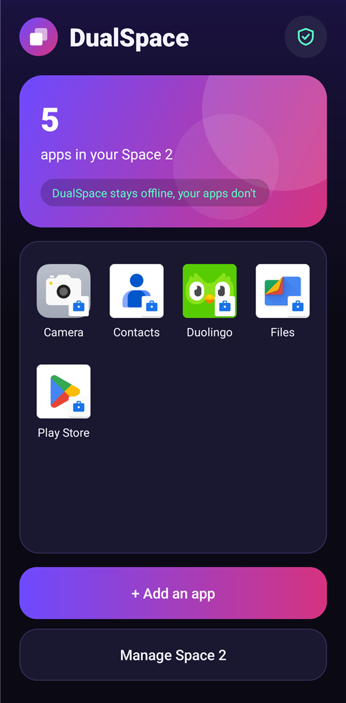
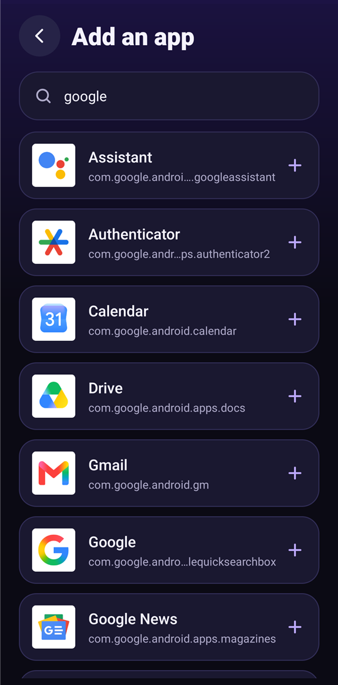
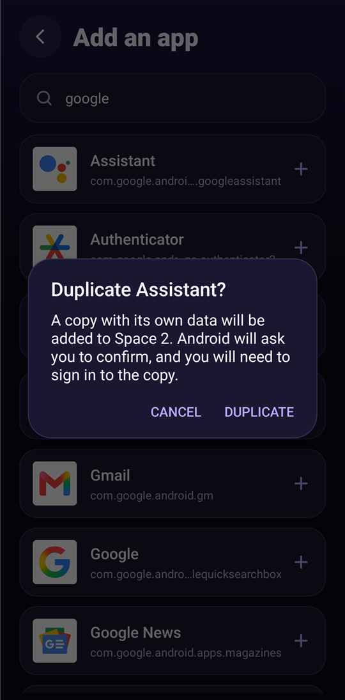
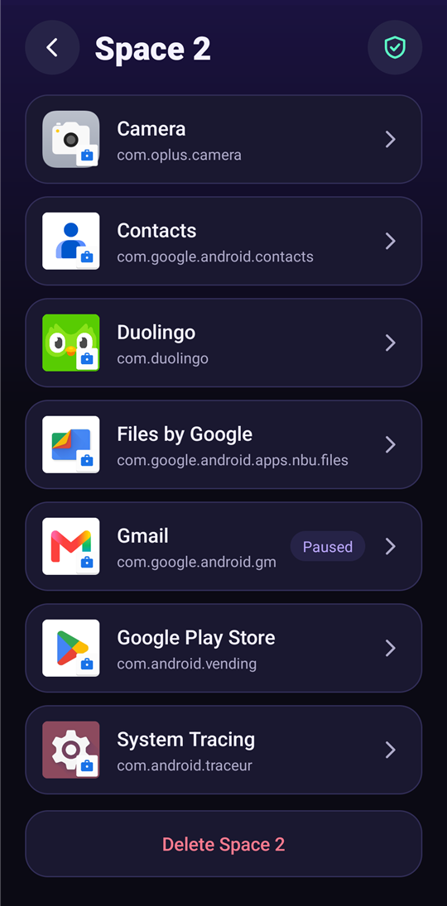

<div align="center">



# Android App Duplicator

**Use two accounts on the same Android app. Open source, no ads, no analytics.**

[](LICENSE)
[](#requirements)
[](https://kotlinlang.org)
[](app/build.gradle.kts)
[](app/src/main/AndroidManifest.xml)
[](https://github.com/Nekuzaky/android-app-duplicator/stargazers)

</div>

Android App Duplicator ships an app called **DualSpace**. It creates an isolated work profile on your phone and installs copies of the apps you choose inside it. Each copy has its own data and its own login, so you can use a second account next to the original app.

Most apps that do this are full of ads. This one has none, and it has no Internet permission at all.

## Screenshots

<p align="center">
  
  
  
  
</p>

## Features

- Duplicate installed apps, including apps split into several APKs
- Enable preinstalled apps such as Gmail inside the second space
- Launch every copy from one home screen
- Search your installed apps
- Pause a copy and resume it later without losing its data
- Remove a single copy without touching the original app
- Delete the whole space in one step
- No ads, no analytics, no account and no third-party libraries

## Privacy

| Component | Internet access | What it means |
| --- | --- | --- |
| DualSpace | No | The manifest does not request the `INTERNET` permission, so the app cannot send data online. |
| Duplicated apps | Yes | Each copy keeps its own network access and sends data to its own services, like the original app. |

DualSpace does not stop a duplicated app from collecting data. Data in the second space is separate from your main profile, but apps can still see that they run on the same device and may link your accounts.

### Permissions

| Permission | Why it is needed |
| --- | --- |
| `QUERY_ALL_PACKAGES` | List your installed apps, on the device only |
| `REQUEST_INSTALL_PACKAGES` | Install copies in the second space |
| `REQUEST_DELETE_PACKAGES` | Remove a copy |
| `dev.nekuz.dualspace.permission.CLONE` | Signature permission that stops apps signed with a different key from requesting a duplication |

## Requirements

- Android 9 (API 28) or later
- A phone that allows work profiles, with no other work profile already set up
- JDK 21 and Android SDK 35 to build from source

Gradle 8.11 does not support the Java 25 runtime bundled with recent Android Studio versions, so use a separate JDK 21.

## Download

Download the signed APK from the [latest release](https://github.com/Nekuzaky/android-app-duplicator/releases/latest) and open it on your phone. Android may ask you to allow installs from the app you opened it with.

The release notes list the SHA-256 checksum of the APK and of its signing certificate.

## Build from source

A build signed with your own key cannot install over the release APK. Delete your Spaces and uninstall the app first.

```bash
git clone https://github.com/Nekuzaky/android-app-duplicator.git
```

```bash
cd android-app-duplicator
```

Create a `local.properties` file that points to your Android SDK:

```properties
sdk.dir=/path/to/Android/Sdk
```

Create a signing key, then add a `keystore.properties` file at the project root. It is ignored by Git, so never commit it or your key:

```properties
storeFile=/path/to/your-key.jks
storePassword=your-password
keyAlias=release
keyPassword=your-password
```

Build the release APK with JDK 21:

```bash
JAVA_HOME=/path/to/jdk-21 ./gradlew assembleRelease
```

Install it on a phone with USB debugging enabled:

```bash
adb install -r app/build/outputs/apk/release/app-release.apk
```

## Usage

1. Open DualSpace and tap **Create Space 2**, then follow the Android setup screens.
2. Tap **Add an app** and choose an app.
3. The first time, tap **Allow** and enable installs for DualSpace on the Android screen.
4. Confirm the installation when Android asks.
5. Open the copy and sign in to your other account.

Your space appears as a work profile, so apps in it show a briefcase badge. Use **Manage Space 2** to pause or remove copies.

## How it works

DualSpace runs in both profiles from the same APK.

1. **Create the space.** The app starts the standard Android managed profile provisioning flow and becomes the owner of that profile.
2. **Choose an app.** The main profile lists its apps, because the work profile cannot see apps that are not installed in it.
3. **Cross the profile boundary.** The request goes through the Android intent forwarder, opened with `addCrossProfileIntentFilter`.
4. **Install the copy.** The work profile reads the APK files and writes them to a `PackageInstaller` session, then Android asks you to confirm. Preinstalled apps are enabled with `enableSystemApp` instead.

`DevicePolicyManager.installExistingPackage` is not used because Android reserves it for device owners and affiliated profile owners.

The installation approach is inspired by [Shelter](https://github.com/PeterCxy/Shelter). Shelter is a more mature project, and it is worth a look if you want more features.

## Limitations

- **One extra copy per app.** Android allows one work profile, so you get the original and one copy.
- **Some apps may refuse to run.** Banking apps in particular may reject work profiles.
- **Installer source changes.** After a duplication by APK copy, Android reports DualSpace as the installer of that package, including for the original app. The effect on Play Store updates has not been verified.
- **Shared updates.** Copies use the same installed package as the original, so an update applies to both.
- **Not suited to the Play Store.** `QUERY_ALL_PACKAGES` and `REQUEST_INSTALL_PACKAGES` are restricted, so the app is meant to be installed directly.
- **Changing the signing key is disruptive.** Installing a build signed with a different key requires deleting the space and uninstalling the app.

## Test status

Tested on one device: Oppo Reno4 Z 5G (CPH2065) with Android 12 and ColorOS.

| Scenario | Status |
| --- | --- |
| Duplicate an app with split APKs (Duolingo) | Works |
| Enable a preinstalled app (Gmail) | Works |
| Open a copy from the home screen | Works |
| Pause and resume a copy | Works |
| Remove a copy, original app kept | Works |
| Cancel at the Android install prompt | Works |
| Duplicate and open Instagram | Works, sign-in not attempted |
| Create a new space from a clean install | Works |
| Delete Space 2 | Works |
| Reject a forged install result on Android 12 | Works |
| Reject a direct launch of the duplication screen | Works |
| Sign in to a second account in a copy | Not tested |
| Snapchat and other popular apps | Not tested |
| Reject a third-party app that imitates the duplication request | Not tested, fixed in code |
| Other phones and Android versions | Not tested |

Reports from other devices are welcome. Please open an issue with your phone model, Android version and the app you tried.

## Disclaimer

This project is not affiliated with the apps you duplicate or with any other app called Dual Space. Some services restrict the use of multiple accounts, so check their terms before you use a copy.

## License

Distributed under the [GNU General Public License v3.0](LICENSE).
